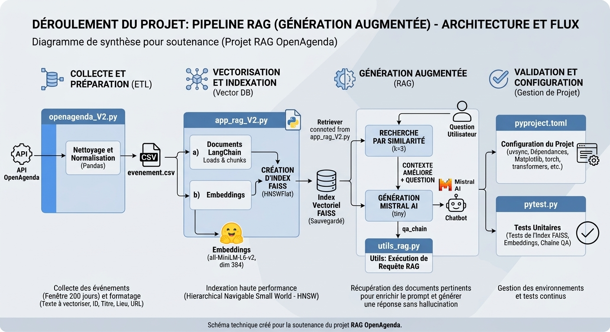
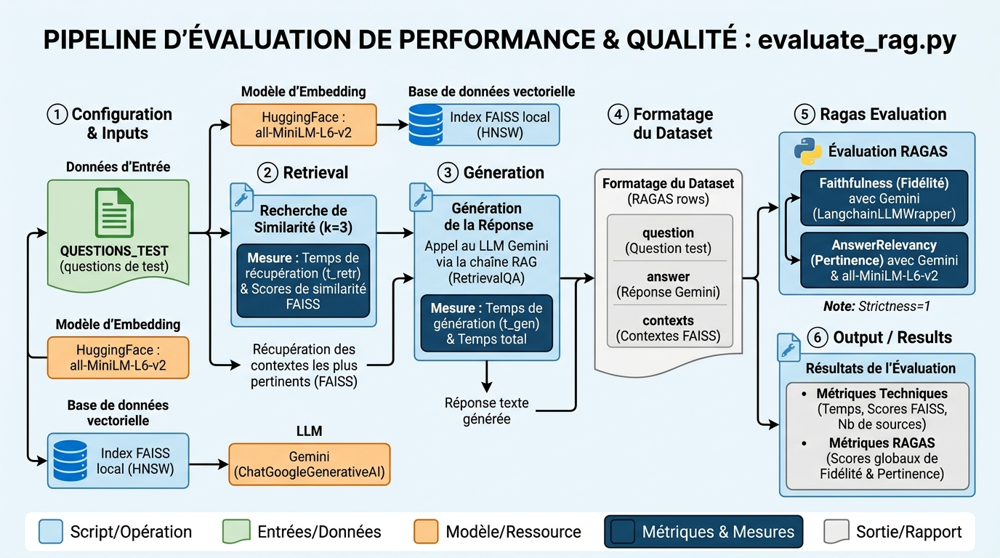

# Concevez et deployer un système RAG

# Système RAG en Chatbot pour les événements sur Paris (  0penagenda + FAISS (Hugging face) + Mistral)


# Description 

Mise en place d'un pipeline

1. Récupération des données sélectionées sur Openagenda

2. Mise en forme des data et préparation et enregistrement dans un fichier CSV

3. Lecture du fichier , LangChain , Indexation FAISS & Maintien des ID ( pour info supplémentaire dans metadata )


Pour le projet :

Clef API à se procurer
 
    - Openagenda
    - Hugging Face
    - Mistral AI
    - GOOGLE_API_KEY

# Déroulement du programme




# installation

 1. Copier le projet dans un répertoire de votre choix

 2. Python et uv doivent être déjà installé sur votre machine

 3. Lncer la commande : uv sync , pour importer les librairies du projet

 4. Renommer exemple.env en .env pour mettre les différentes clefs API : Hugging Face , OpenAgenda et Mistral

 5. Lancer la commande uv run jupyter lab : openagenda.ipynb pour lire un agenda et pour le RAG : app_rag.ipynb


# liste des questions différentes pour le RAG

    uv run python mquestion1.py 

    uv run python mquestion2.py 

    uv run python mquestion3.py 

    uv run python mquestion4.py 

    uv run python mquestion5.py 


    uv run python gquestion1.py 

    uv run python gquestion2.py 

    uv run python gquestion3.py 

    uv run python gquestion4.py 

    uv run python gquestion5.py 

# test unitaire


 1. Lancer la commande :  uv run python -m pytest -v


## Mesure metrics RAGAS




## 📂 Structure du Répertoire

```text
projet_11

├── pyproject.toml                                  # Gestion des dépendances Python (uv)
├── data                                            # répertoire  de document 
|    └── evenement.csv                              # fichier evenement sélectioné dans openagenda extrait et préparé pour LLM
|    └── index_openagenda_hnsw                      # Répertoire fichierss : Index FAISS optimisé (HNSW) 
|         └── index.faiss    
|         └── index.pkl  
|    └── dico_data
|         └── dico_data_opa.xls                     # dictionnaire  de données fichiers openagenda
|         └── annote_dataset.json                   # json pour Q_R annote
├── openagenda.ipynb                                # notebook gestion data openagenda
├── Q_R_Annote.py                                   # question / réponse annoté
├── app_rag.ipynb                                   # notebook gestion RAG et gestion avec Mistral
├── evaluate_rag.py                                 # Mesure des temps de traitement RAGAS
├── example.env                                     # fichier exemple .env pour les clefs API
├── openagenda_V2.py                                # gestion data openagenda
├── app_rag_V2.py                                   # fichier gestion RAG
├── maquestion1.py                                  # Question RAG N°1
├── maquestion2.py                                  # Question RAG N°2
├── maquestion3.py                                  # Question RAG N°3
├── maquestion4.py                                  # Question RAG N°4
├── maquestion5.py                                  # Question RAG N°5
├── tests                                           # répertoire  de document 
|    └── test_app.py                                # procédure de test 
├── pytest.ini                                      # fichier de configuration de pytest
└── README.md                                       # Documentation du projet
```
